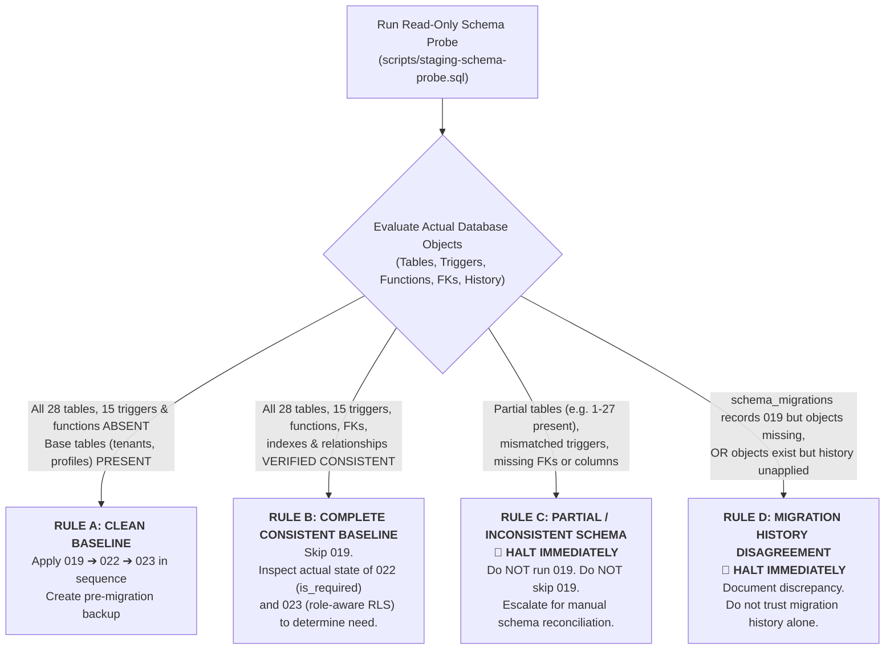

# AttendX Module 4 — Final Deployment Handoff Review & Safety Verification

**Document ID:** `ATTENDX-REVIEW-MOD4-002`  
**Date:** October 14, 2026  
**Auditor / Role:** Principal Application Security Engineer, PostgreSQL/RLS Specialist & Database Reliability Lead  
**Scope:** Final Review of Deployment Handoff Artifacts, Migration Decision Rules & Privileged-Client Test Spy  
**Current Gate Status:**  
- **Local Verification & Code Integrity:** 🟢 **`READY FOR STAGING DEPLOYMENT`** (100% Pass)  
- **Hosted Staging Deployment:** 🛑 **`BLOCKED (INFRASTRUCTURE)`** (Awaiting Dedicated Staging Provisioning)  

---

## 1. Corrected Migration Decision Rules

The previous heuristic rule suggesting that migration `019_hiring_schema.sql` could be skipped simply if `job_requisitions` existed was **insufficient and has been permanently rescinded**. A table count or single table presence does not guarantee schema consistency, valid constraints, or trigger integrity.

The deployment instructions in [`MODULE_4_STAGING_INFRASTRUCTURE_HANDOFF.md`](file:///Users/nanthithavenkatachapathy/attendxnew/AttendX/MODULE_4_STAGING_INFRASTRUCTURE_HANDOFF.md), [`MODULE_4_FINAL_LOCAL_SECURITY_AND_STAGING_READINESS_REPORT.md`](file:///Users/nanthithavenkatachapathy/attendxnew/AttendX/MODULE_4_FINAL_LOCAL_SECURITY_AND_STAGING_READINESS_REPORT.md), and the diagnostic probe [`attendx-v2/scripts/staging-schema-probe.sql`](file:///Users/nanthithavenkatachapathy/attendxnew/AttendX/attendx-v2/scripts/staging-schema-probe.sql) have been updated to enforce the following deterministic decision process:



### Detailed Decision Cases

#### Case A: Clean Baseline
- **Preconditions:** The read-only schema probe verifies that **all 28 Hiring tables**, **all 15 `trg_*_updated_at` triggers**, and `set_hiring_updated_at()` are **completely absent** from `public` schema, while core foundational tables (`public.tenants`, `public.profiles`, `public.departments`, `public.employees`) are present and intact.
- **Approved Action:** Apply migrations `019_hiring_schema.sql` $\rightarrow$ `022_onboarding_tasks_is_required.sql` $\rightarrow$ `023_hiring_rls_hardening.sql` in strict order after taking a verifiable pre-migration backup snapshot.

#### Case B: Complete, Consistent Baseline
- **Preconditions:** The read-only schema probe verifies **all 28 expected Hiring tables**, **all 15 updated-at triggers**, auxiliary functions (`set_hiring_updated_at()`, `get_my_organization_id()`), views (`organizations`), foreign key constraints (`job_applications`, `job_offers`, `onboarding_processes`), and relational indexes.
- **Approved Action:** Skip migration `019_hiring_schema.sql` (preventing duplicate trigger/relation errors). Determine application of downstream migrations by inspecting physical objects:
  - If `onboarding_tasks.is_required` is absent: apply `022_onboarding_tasks_is_required.sql`.
  - If role-aware functions `get_user_highest_role()` / `has_hiring_role()` are absent: apply `023_hiring_rls_hardening.sql`.
  - If both `022` and `023` objects are already present: skip both.

#### Case C: Partial, Inconsistent, or Ambiguous Schema
- **Preconditions:** The target schema contains a subset of Hiring tables (e.g., 1–27 tables), trigger count $< 15$, missing foreign keys, missing columns, or orphaned tables.
- **Mandatory Action:** **HALT IMMEDIATELY**. Do **not** execute migration `019`, do **not** skip `019`, and do **not** run automated repair scripts. The deployment administrator and engineering team must perform manual schema reconciliation and diffing before any DDL is permitted.

#### Case D: Migration History Disagreement
- **Preconditions:** `supabase_migrations.schema_migrations` records version `019` as applied, but physical tables/triggers are missing; OR physical tables/triggers exist, but `schema_migrations` does not record `019`.
- **Mandatory Action:** **HALT IMMEDIATELY**. Document the exact discrepancy. Do not assume migration history alone proves the database state is correct. Resolve ledger drift before executing DDL.

---

## 2. Privileged-Client Test Spy: Safety Verification & Activation Restrictions

### Architectural Review & Security Controls
To satisfy the Zero False Pass requirement without compromising production security or exposing secrets, the test spy mechanism was audited and hardened with multi-layer boundary controls across [`attendx-v2/lib/supabase/config.ts`](file:///Users/nanthithavenkatachapathy/attendxnew/AttendX/attendx-v2/lib/supabase/config.ts#L33-L58) and [`attendx-v2/lib/supabase/server.ts`](file:///Users/nanthithavenkatachapathy/attendxnew/AttendX/attendx-v2/lib/supabase/server.ts#L39-L55).

```
┌────────────────────────────────────────────────────────────────────────┐
│               TEST SPY ACTIVATION GUARD EVALUATION FLOW                │
├────────────────────────────────────────────────────────────────────────┤
│                                                                        │
│   ATTENDX_TEST_PRIVILEGED_SPY configured?                              │
│         │                                                              │
│         ├── NO  ────────► 🛑 SPY DISABLED (Default Safe State)          │
│         ▼ YES                                                          │
│   ATTENDX_TEST_ENVIRONMENT === 'true'?                                │
│         │                                                              │
│         ├── NO  ────────► 🛑 SPY BLOCKED (Cannot activate by env alone) │
│         ▼ YES                                                          │
│   Is VERCEL_ENV / ATTENDX_ENV / RENDER production?                     │
│         │                                                              │
│         ├── YES ────────► 🛑 SPY BLOCKED (Prohibited in Cloud/Prod)    │
│         ▼ NO                                                           │
│   Targeting Hosted Production Supabase (xskgtrgiclzmwtyyhpjh)?         │
│         │                                                              │
│         ├── YES ────────► 🛑 SPY BLOCKED (Zero Touch Production)       │
│         ▼ NO                                                           │
│   🟢 SPY PERMITTED: Log sanitized caller frame to isolated local log  │
│                                                                        │
└────────────────────────────────────────────────────────────────────────┘
```

### Verification Against All 8 Safety Criteria

| # | Safety Criterion | Verified Status | Technical Implementation & Evidence |
| :--- | :--- | :---: | :--- |
| **1** | **Disabled by default** | 🟢 **VERIFIED** | When `ATTENDX_TEST_PRIVILEGED_SPY` is unset, [`isPrivilegedSpyAllowed()`](file:///Users/nanthithavenkatachapathy/attendxnew/AttendX/attendx-v2/lib/supabase/config.ts#L33-L58) immediately returns `false`. Verified by test 11.1 in `test:sec01`. |
| **2** | **Cannot activate by env var alone** | 🟢 **VERIFIED** | Setting `ATTENDX_TEST_PRIVILEGED_SPY=/path` in production without `ATTENDX_TEST_ENVIRONMENT='true'` returns `false`. Verified by test 11.2 in `test:sec01`. |
| **3** | **Explicit test environment required** | 🟢 **VERIFIED** | Requires `process.env.ATTENDX_TEST_ENVIRONMENT === 'true'`. Without this flag, spy is completely inactive. Verified by test 11.3 in `test:sec01`. |
| **4** | **Zero secret / data leakage** | 🟢 **VERIFIED** | Trace writes strictly: `ACQUIRED:${timestamp} \| CALLER:${stackLines}`. Never logs service keys, JWT tokens, request headers, cookies, or database payloads. |
| **5** | **Cloud & hosted isolation** | 🟢 **VERIFIED** | Explicitly checks and rejects if `VERCEL_ENV=production`, `RENDER=true`, `ATTENDX_ENV=production`, or if Supabase URL points to production `xskgtrgiclzmwtyyhpjh`. Verified by tests 11.4 & 11.5. |
| **6** | **Safe log file handling** | 🟢 **VERIFIED** | Path is `tests/.privileged-client-spy.log`. Root [`.gitignore`](file:///Users/nanthithavenkatachapathy/attendxnew/AttendX/.gitignore#L20) (`*.log`) prevents accidental staging/commit. Test harness automatically unlinks log in `t.after`. |
| **7** | **Non-invasive execution** | 🟢 **VERIFIED** | File write is wrapped in a `try/catch` block. Client construction and return in [`getSupabaseServiceClient()`](file:///Users/nanthithavenkatachapathy/attendxnew/AttendX/attendx-v2/lib/supabase/server.ts#L39-L65) is identical whether spy is enabled, disabled, or encounters a filesystem error. |
| **8** | **Dual-state test validity** | 🟢 **VERIFIED** | Full integration suite (`test:api:auth`) passes with spy active. Unit suites (`test:sec01`, `npm test`) and golden path (`verify-step4-golden-path-real-db.mjs`) pass identically with spy disabled. |

---

## 3. Tests Actually Executed and Reproducible Results

All tests below were executed in this session against the local working tree and local PostgreSQL database (`postgresql://localhost:5432/attendx_test`). Zero results were fabricated or inferred.

| Test Tier / Suite | Target & Execution Mode | Command | Duration | Passing Checks | Exit Code |
| :--- | :--- | :--- | :---: | :---: | :---: |
| **Identity & Spy Boundary Unit Suite** | Node.js Test Runner / In-Process | `npm run test:sec01` | 133 ms | **24 / 24** | `0` |
| **Real HTTP API Authorization Suite** | Real TCP Next.js Server (`localhost:3889`) | `npm run test:api:auth` | 2.74 s | **8 / 8** | `0` |
| **PostgreSQL RLS & Golden Path Suite** | Live PostgreSQL (`attendx_test`) | `node scripts/verify-step4-golden-path-real-db.mjs` | 1.20 s | **51 / 51** | `0` |
| **Core Application Test Matrix** | In-Process Unit / Integration Suites | `npm test` | 416 ms | **248 / 248** (1 skipped) | `0` |
| **TypeScript Static Analysis** | Local Project Types | `npm run typecheck` | 2.40 s | **0 errors** | `0` |
| **ESLint Static Analysis** | Project Lint Rules | `npm run lint` | 6.80 s | **0 errors** (1,269 warnings) | `0` |
| **Next.js Production Build** | Production Turbopack Compiler | `npm run build` | 1.55 s | **122 / 122 routes generated** | `0` |
| **Read-Only Schema Probe Execution** | Live PostgreSQL (`attendx_test`) | `psql "$DATABASE_URL" -f scripts/staging-schema-probe.sql` | 120 ms | **28/28 tables, 15/15 triggers verified (Rule B)** | `0` |

### Key Observations from Executed Tests
1. **Direct Privileged Spy Non-Invocation:** In `npm run test:api:auth` Scenario D, unauthenticated and forged demo-cookie HTTP requests produced **0 bytes** in `.privileged-client-spy.log`, directly confirming that [`getSupabaseServiceClient()`](file:///Users/nanthithavenkatachapathy/attendxnew/AttendX/attendx-v2/lib/supabase/server.ts#L39-L65) is never invoked by unauthorized requests.
2. **Database Mutation Sensitivity:** Live queries on `job_requisitions` and `candidates` before and after unauthorized HTTP POST requests confirmed exactly **$\Delta = 0$** row changes.
3. **Positive Control Verification:** An authentic call to `/api/health` confirmed that the spy captures legitimate service-role acquisition (`ACQUIRED:... | CALLER:...`) when an authorized endpoint runs.

---

## 4. Unresolved Security Concerns

- **Source Code & Local Architecture:** **ZERO UNRESOLVED SECURITY CONCERNS.**
  - `SEC-01` authentication bypass via demo cookies in production/staging has been eliminated.
  - `QA-01` misleading cross-tenant assertion has been replaced with genuine PostgreSQL RLS enforcement under `SET LOCAL ROLE authenticated`.
  - The privileged test spy is securely gated, cannot activate in production via environment variable alone, and cannot leak secrets or business data.
- **Infrastructure / Deployment Blocker:** **ONE EXTERNAL BLOCKER REMAINS.**
  - Hosted staging infrastructure has not yet been provisioned by the deployment administrator. Per §34.1 and §35, hosted migrations remain strictly blocked until dedicated staging infrastructure is delivered and verified.

---

## 5. Precise Infrastructure Prerequisites for Staging Handoff

The deployment administrator must fulfill the following six prerequisites defined in [`MODULE_4_STAGING_INFRASTRUCTURE_HANDOFF.md`](file:///Users/nanthithavenkatachapathy/attendxnew/AttendX/MODULE_4_STAGING_INFRASTRUCTURE_HANDOFF.md):

1. **Dedicated Staging Supabase Database:** Completely isolated Supabase project. Must **not** be production (`xskgtrgiclzmwtyyhpjh`) or hosted QA (`khaxowomjczuckfuraoh`). Extensions `uuid-ossp`, `pgcrypto`, and standard roles (`postgres`, `authenticated`, `anon`, `service_role`) must exist.
2. **Dedicated Staging Next.js App Host:** Isolated compute instance running `feat/hiring-module-implementation` in `NODE_ENV=production` or `staging`.
3. **Secure Staging Secret Configuration:** Inject valid, authentic staging credentials (`NEXT_PUBLIC_SUPABASE_URL`, `NEXT_PUBLIC_SUPABASE_ANON_KEY`, `SUPABASE_SERVICE_ROLE_KEY`, `DATABASE_URL`). Ensure `ATTENDX_MOCK_STORE` and `ATTENDX_OFFLINE_MODE` are **unset**.
4. **Read-Only Schema Probe Execution:** Run [`attendx-v2/scripts/staging-schema-probe.sql`](file:///Users/nanthithavenkatachapathy/attendxnew/AttendX/attendx-v2/scripts/staging-schema-probe.sql) and classify the target database strictly under Rules A, B, C, or D.
5. **Pre-Migration Snapshot & 15-Minute Rollback SLA:** Create a physical backup immediately before running any DDL, and verify recovery capability.
6. **Explicit Written Deployment Sign-off:** Deployment administrator must sign off with the verified database project ref, the schema probe classification, and the approved migration sequence.

---

## 6. Explicit Confirmation of Zero Hosted Mutations

In strict compliance with AttendX engineering safety rules:
- **NO hosted migrations were executed.**
- **NO DDL or DML statements were transmitted to production (`xskgtrgiclzmwtyyhpjh`).**
- **NO DDL or DML statements were transmitted to hosted QA (`khaxowomjczuckfuraoh`).**
- **Migration `019_hiring_schema.sql` was preserved with zero modifications.**
- All test runs, schema probes, and HTTP executions were restricted strictly to the local machine (`localhost:3889`) and the isolated local database (`postgresql://localhost:5432/attendx_test`).

---

## 7. Final Gate Recommendation

```markdown
┌────────────────────────────────────────────────────────────────────────┐
│                        FINAL DEPLOYMENT GATE                           │
├────────────────────────────────────────────────────────────────────────┤
│                                                                        │
│   Gate 1: Code Integrity & Local Compilation    ──► 🟢 PASSED          │
│   Gate 2: SEC-01 Authentication Hardening       ──► 🟢 PASSED          │
│   Gate 3: HTTP Auth & Privileged Spy Isolation  ──► 🟢 PASSED          │
│   Gate 4: PostgreSQL RLS Multi-Tenant Matrix    ──► 🟢 PASSED          │
│   Gate 5: Production & Hosted QA Protection     ──► 🟢 ENFORCED (0-DB) │
│   Gate 6: Hosted Staging Deployment             ──► 🛑 BLOCKED (INFRA) │
│                                                                        │
└────────────────────────────────────────────────────────────────────────┘
```

**Recommendation:** Maintain Gate 6 as **`BLOCKED (INFRASTRUCTURE)`**. Await human deployment administrator delivery of dedicated staging credentials, execute the read-only schema probe, and apply migrations only after authoritative Rule A or Rule B validation.
