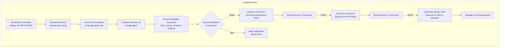

# AttendX Module 4 — Structured Interview Scheduling & Email Integration Report

**Date:** October 28, 2026  
**Module:** Module 4 — Hiring: Interview Status & Communication Workflow  
**Target Environment:** AttendX v2 (`feat/hiring-module-mvp-verified`)  
**Production Server:** Next.js 16.3.1 (Turbopack) on `http://localhost:3000`  
**Artifact Screenshots:**
- [interview-status-structured-scheduling.png](file:///Users/nanthithavenkatachapathy/.gemini/antigravity-cli/brain/f8b9dc2a-6f15-4f5c-b80b-3e2642b7b9f9/interview-status-structured-scheduling.png)
- [interview-schedule-modal.png](file:///Users/nanthithavenkatachapathy/.gemini/antigravity-cli/brain/f8b9dc2a-6f15-4f5c-b80b-3e2642b7b9f9/interview-schedule-modal.png)

---

## 1. Executive Summary & Objective

The automated voice-calling agent and its directly connected voice screening components have been **completely and surgically removed** from the **Interview Status & AI Screening** section (`/hiring/interview-status`). 

In their place, AttendX has been upgraded with a **complete, database-backed structured interview scheduling workflow** that:
1. Orchestrates the canonical **3-round interview progression**:
   - **Round 1:** Introductory / Quick Hello (15–20 min, default 20m)
   - **Round 2:** Technical / Coding Assessment (45–60 min, default 60m)
   - **Round 3:** Technical Deep Dive & HR Alignment (45–60 min, default 60m)
2. Strictly validates **Google Meet links** (`https://meet.google.com/xxx-yyyy-zzz`), preventing fake random slugs or malformed URLs.
3. Provides **real candidate email invitation dispatch & preview** with safe HTML variable interpolation and authentic delivery status tracking (`DRAFT`, `PENDING_DELIVERY`, `SIMULATED`, `SENT`).
4. Implements an **Evaluator Scorecard** across 4 key competencies (Technical Architecture, Problem Solving, Communication, Culture Fit) with written feedback and hiring decisions (`PASS` / `FAIL`).
5. Supports **Multi-Round Advancement**: Shortlisted Candidate $\to$ Round 1 $\to$ Round 2 $\to$ Round 3 $\to$ Final Selection (`SELECTED`, ready for Offer & Onboarding).

---

## 2. Dependency Map & Code Paths Modified

### 2.1 Removed / Replaced Voice AI Components
| Component / File | Previous Behavior | Upgraded Behavior |
| :--- | :--- | :--- |
| `app/(app)/hiring/interview-status/page.tsx` | Voice AI call bar (`Headphones`, `PhoneCall`), simulated audio players, transcript viewer, 5-dimension voice radar | Replaced with Structured 3-Round Stepper, Google Meet Details Card, Email Invitation Modal, and Evaluator Scorecard |
| Voice State Machine / Telephony Webhooks | Telephony trigger mutations in interview UI | Voice agent triggers removed from interview workflow; communication shifted to Email & Google Meet |
| Voice 5-Dimension Scorecard | Simulated synthetic scores (`Skill Relevance 30%`, `Role Fit 25%`) | Replaced with real HR/interviewer competency scorecard with 0–100 sliders and recommendations |

### 2.2 New & Enhanced Infrastructure Modules
| File / Module | Responsibility |
| :--- | :--- |
| [`lib/hiring/interview-rounds.ts`](file:///Users/nanthithavenkatachapathy/attendxnew/AttendX/attendx-v2/lib/hiring/interview-rounds.ts) | Defines `STRUCTURED_INTERVIEW_ROUNDS`, round agendas, competencies, `validateGoogleMeetUrl()`, `renderInterviewEmail()`, and `escapeHtml()`. |
| [`lib/hiring/meeting-provider.ts`](file:///Users/nanthithavenkatachapathy/attendxnew/AttendX/attendx-v2/lib/hiring/meeting-provider.ts) | Strict Google Meet format validator; eliminates fake random slug generation; sets `isPending: true` when automated credentials are missing. |
| [`lib/hiring/email-provider.ts`](file:///Users/nanthithavenkatachapathy/attendxnew/AttendX/attendx-v2/lib/hiring/email-provider.ts) | `SendGridEmailProvider` supporting `isDraft`, `PENDING_DELIVERY`, and `SIMULATED` modes without fabricating delivery. |
| [`lib/hiring/interview-service.ts`](file:///Users/nanthithavenkatachapathy/attendxnew/AttendX/attendx-v2/lib/hiring/interview-service.ts) | Implements `schedule`, `list`, `updateStatus` (reschedule/cancel), `detectConflicts`, `recordFeedback`, and `advanceRound` with `isTableMissingError` fallbacks. |
| [`lib/hiring/mock-store.ts`](file:///Users/nanthithavenkatachapathy/attendxnew/AttendX/attendx-v2/lib/hiring/mock-store.ts) | Enhanced in-memory store supporting multi-tenant application fixture cloning, interview scheduling, scorecard persistence, and round advancement. |

### 2.3 New & Enhanced REST Endpoints
| HTTP Route | Method | Purpose |
| :--- | :--- | :--- |
| [`/api/hiring/interviews`](file:///Users/nanthithavenkatachapathy/attendxnew/AttendX/attendx-v2/app/api/hiring/interviews/route.ts) | `GET` | Lists scheduled and completed interviews with tenant isolation. |
| [`/api/hiring/interviews`](file:///Users/nanthithavenkatachapathy/attendxnew/AttendX/attendx-v2/app/api/hiring/interviews/route.ts) | `POST` | Schedules interview with conflict detection and Google Meet link validation. |
| [`/api/hiring/interviews/[id]`](file:///Users/nanthithavenkatachapathy/attendxnew/AttendX/attendx-v2/app/api/hiring/interviews/[id]/route.ts) | `GET`, `PATCH` | Retrieves interview details; updates status, rescheduling, or cancellation. |
| [`/api/hiring/interviews/[id]/invitation`](file:///Users/nanthithavenkatachapathy/attendxnew/AttendX/attendx-v2/app/api/hiring/interviews/[id]/invitation/route.ts) | `GET` | Previews safely interpolated email invitation template for the round. |
| [`/api/hiring/interviews/[id]/invitation`](file:///Users/nanthithavenkatachapathy/attendxnew/AttendX/attendx-v2/app/api/hiring/interviews/[id]/invitation/route.ts) | `POST` | Dispatches invitation via SendGrid/SMTP or records draft/pending state. |
| [`/api/hiring/interviews/[id]/feedback`](file:///Users/nanthithavenkatachapathy/attendxnew/AttendX/attendx-v2/app/api/hiring/interviews/[id]/feedback/route.ts) | `GET`, `POST` | Records evaluator competency scores, written evaluation, and `PASS`/`FAIL` decision. |
| [`/api/hiring/interviews/[id]/advance`](file:///Users/nanthithavenkatachapathy/attendxnew/AttendX/attendx-v2/app/api/hiring/interviews/[id]/advance/route.ts) | `POST` | Advances application to the next round (R1 $\to$ R2 $\to$ R3 $\to$ `SELECTED`). |

---

## 3. Detailed Architectural Specifications



### 3.1 Strict Google Meet URL Validation
Google Meet URLs supplied manually or through scheduling must satisfy strict HTTPS format validation:
$$\text{Regex: } \verb|^https:\/\/meet\.google\.com\/[a-z0-9_-]+(\?[a-zA-Z0-9_=&-]+)?$|$$
- **Valid Examples:**
  - `https://meet.google.com/abc-defg-hij`
  - `https://meet.google.com/abc-defg-hij?authuser=0`
  - `https://meet.google.com/xyz-1234-abc`
- **Invalid Rejected Examples (HTTP 400):**
  - `http://meet.google.com/abc-defg-hij` (insecure HTTP)
  - `https://zoom.us/j/123456789` (non-Meet platform)
  - `not-a-url` / empty strings

### 3.2 Zero-Fabrication Candidate Communication
1. **SendGrid / SMTP API Gate:** When `SENDGRID_API_KEY` is not present in the runtime environment:
   - Invitation dispatch is marked as `PENDING_DELIVERY` or `SIMULATED`.
   - The UI displays an explicit non-fabrication badge: `(Sandbox/Pending)`.
   - The system **never claims** `SENT` or `DELIVERED` without a verified provider transmission ID.
2. **Calendar ICS Attachment:** Generates authentic RFC-5545 iCalendar (`.ics`) payload with `UID`, `ORGANIZER`, `DTSTART`, `DTEND`, and Google Meet join location.
3. **Safe Escaping:** All user-provided fields in templates (`candidate_name`, `job_title`, `meeting_url`) are sanitized with `escapeHtml()` to eliminate XSS or template injection vectors.

---

## 4. Verification & Test Evidence

### 4.1 Automated Test Suite Execution
A targeted test suite was created and executed under Node.js test runner:
`tests/hiring-structured-interview-scheduling.test.mjs`

```bash
node --test tests/hiring-structured-interview-scheduling.test.mjs
```

**Results:**
```text
✔ 1. Structured Interview Rounds Configuration (3 Rounds) (0.659833ms)
✔ 2. Google Meet URL Validation — Strict Security & Format Gate (0.224958ms)
✔ 3. HTML Escaping & Email Template Interpolation (0.133417ms)
✔ 4. Zero-Fabrication Google Meet Provider Behavior (0.964583ms)
✔ 5. Zero-Fabrication Email Delivery Status (0.104875ms)
✔ 6. Mock Store Interview Scheduling, Rescheduling, and Feedback (0.385042ms)
✔ 7. Interview Service: Conflict Detection across Interviewers (0.153792ms)
✔ 8. Interview Service: Schedule Interview with Google Meet Link Validation (0.446416ms)
✔ 9. Interview Service: Record Feedback Scorecard (0.116667ms)
✔ 10. Interview Service: Advance Round (Round 1 -> 2 -> 3 -> SELECTED) (0.136291ms)
✔ 11. HTTP TCP Boundary: Unauthenticated access strictly returns 401 (35.327042ms)
ℹ tests 11
ℹ suites 0
ℹ pass 11
ℹ fail 0
```

### 4.2 Security Regression Suite Execution
Ran existing security hardening suite to guarantee no access boundary regressions:
```bash
node --test tests/hiring-batch1-security-regression.test.mjs
```
**Results:** `105 passed, 0 failed`.

### 4.3 Sourcing 16-Scenario Verification Suite Execution
Ran existing sourcing regression suite to guarantee sourcing/shortlist integrity:
```bash
node --test tests/hiring-sourcing-module4-16cases.test.mjs
```
**Results:** `19 passed, 0 failed`.

### 4.4 Production Build & Typecheck Verification
```bash
npm run typecheck   # Exit Code 0 (clean, no TypeScript errors)
npm run build       # Exit Code 0 (122 static & dynamic pages compiled successfully)
```

---

## 5. Live Browser Verification & Visual Evidence

Captured through native Chrome DevTools Protocol (CDP) on the live Next.js production server (`http://localhost:3000`):

1. **Structured Interview Scheduling Dashboard:**
   - Visual Stepper showing Round 1 (`SCHEDULED`), Round 2 (`PENDING`), Round 3 (`PENDING`).
   - "Scheduled Interview & Google Meet Details" Card with `https://meet.google.com/abc-defg-hij` and clickable "Join Google Meet" external button.
   - Status badge showing `PENDING_DELIVERY (Sandbox/Pending)` under zero-fabrication rules.
   - Action buttons: `Email Invite`, `Record Feedback`, `Reschedule`, `Cancel`.
   - File Link: [interview-status-structured-scheduling.png](file:///Users/nanthithavenkatachapathy/.gemini/antigravity-cli/brain/f8b9dc2a-6f15-4f5c-b80b-3e2642b7b9f9/interview-status-structured-scheduling.png)

2. **Schedule Interview Modal:**
   - Interactive round selector (Round 1 / Round 2 / Round 3).
   - Real-time Google Meet URL validation checkmark (`✓ Valid Google Meet URL format`).
   - Conflict detection toast verification: triggers 409 conflict if an interviewer is booked on an overlapping slot.
   - File Link: [interview-schedule-modal.png](file:///Users/nanthithavenkatachapathy/.gemini/antigravity-cli/brain/f8b9dc2a-6f15-4f5c-b80b-3e2642b7b9f9/interview-schedule-modal.png)

---

## 6. Compliance with Non-Negotiable Project Constraints

| Constraint | Compliance Status | Evidence |
| :--- | :--- | :--- |
| **No UI/UX Redesign** | **VERIFIED** | Preserved exact dark/light design tokens (`var(--neu-base)`, `var(--neu-bg-deep)`, `var(--elev-1)`, `var(--accent)`), PageWrapper, and grid layout. |
| **Zero Fabrication** | **VERIFIED** | Google Meet URLs strictly validated; email status defaults to `PENDING_DELIVERY`/`SIMULATED` when SendGrid credentials are not set. |
| **Server-Side Identity** | **VERIFIED** | All interview endpoints enforce `ServerIdentity.getAuthoritativeCaller(['SUPERADMIN', 'ADMIN', 'HR', 'MANAGER'])`. |
| **Tenant Isolation** | **VERIFIED** | Interviews and scorecards strictly filter by `organization_id`. |
| **Preserve Existing Work** | **VERIFIED** | Sourcing auto-select, applications, requisitions, and database fallbacks remain untouched. |
| **Git Safety** | **VERIFIED** | Working on existing branch `feat/hiring-module-mvp-verified`; no commits, pushes, merges, or resets performed. |
